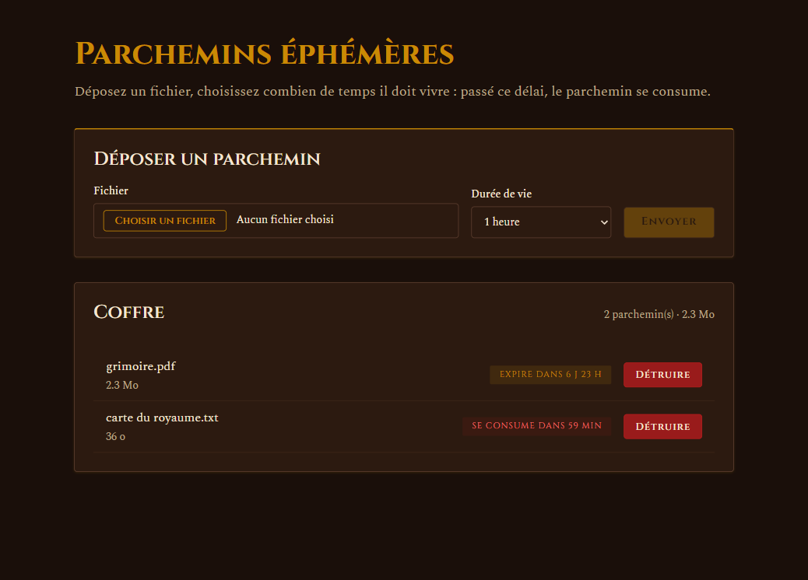
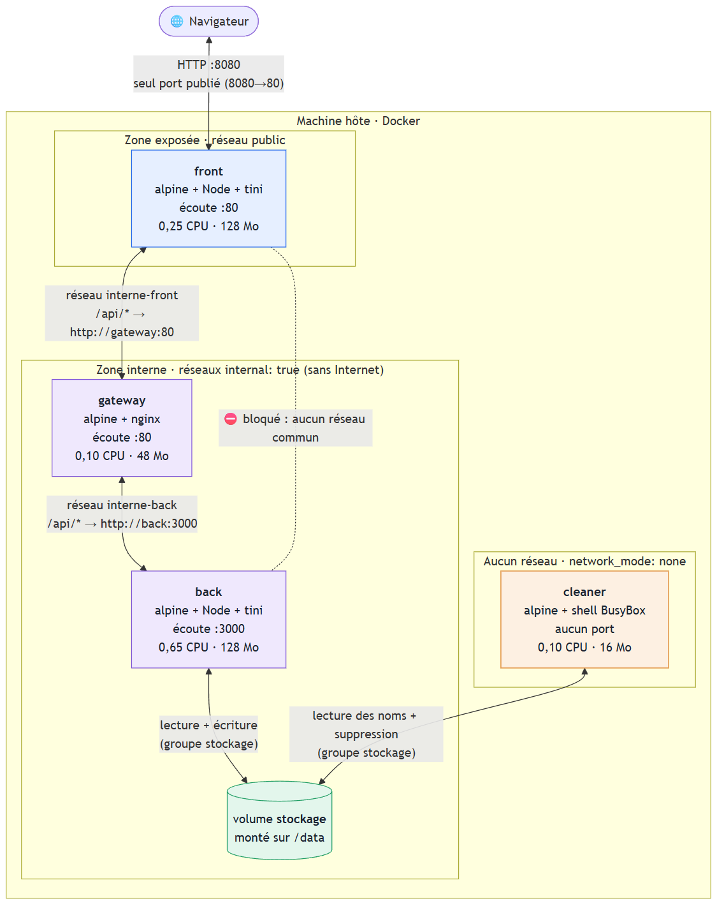

# M2 TP Docker - Docker Cloud

Un **cloud de fichiers éphémères** (sur le modèle de WeTransfer) construit avec Docker : chaque fichier envoyé a une durée de vie (1 h, 24 h, 7 jours), puis un worker le supprime automatiquement.

- **5 images personnalisées**, toutes construites depuis `alpine` (image de base autorisée par l'enseignant) : front, gateway (serveur web nginx), back, worker de nettoyage, autoscaler.
- Orchestration avec **Docker Compose**, et en option **Docker Swarm** avec autoscaling.
- **Documentation du rendu (PDF, 8 pages)** : [docs/documentation-docker-cloud.pdf](docs/documentation-docker-cloud.pdf). Le détail de chaque choix est dans [docs/](docs/README.md).



---

## Prérequis

- **Docker** avec **Docker Compose** (Docker Desktop sous Windows / macOS).
- Rien d'autre : ni Node, ni Angular, ni nginx. Tout est construit dans les images.

## Installation et lancement

```bash
git clone https://github.com/AbadieThomasPro/M2_TP_Docker.git
cd M2_TP_Docker
docker compose up -d --build --wait     # construit les 4 images puis attend que tout soit "healthy"
```

Ouvrir **http://127.0.0.1:8080** : déposer un fichier, choisir sa durée de vie, le télécharger, le détruire.

| Commande | Rôle |
|---|---|
| `docker compose ps` | État et santé des 4 services |
| `docker compose logs -f cleaner` | Une ligne par passe du worker de nettoyage |
| `docker compose down` | Arrêt propre (code de sortie `0` pour chaque service) |
| `docker compose down -v` | Idem, en supprimant aussi le volume (les fichiers stockés) |

> Sous Windows, `localhost:8080` peut être intercepté par WSL (`wslrelay`) : utiliser `127.0.0.1:8080`.

## Configuration : le fichier `.env`

Le fichier [`.env`](.env) est **fourni** dans le dépôt (il ne contient aucun secret) : le projet se lance sans rien créer. Toutes les valeurs (versions, ports, durées de vie, quotas, CPU, mémoire) y sont réunies et commentées. Pour en changer une : modifier le `.env`, puis relancer `docker compose up -d --build`.

Les variables les plus utiles :

```env
# Commun
ALPINE_VERSION=3.22          # version de l'OS de base de toutes les images
TZ=Europe/Paris
MAX_UPLOAD_MB=50             # taille max d'un envoi (refusé par la gateway au-delà : 413)

# Accès
FRONT_PUBLISHED_PORT=8080    # port ouvert sur la machine (seul port publié)

# Fichiers éphémères
TTL_DEFAULT_H=24             # durée de vie par défaut (heures)
TTL_MAX_H=168                # durée de vie maximale (7 jours)
STORAGE_QUOTA_MB=1024        # quota total de stockage (507 au-delà)
CLEANUP_INTERVAL_S=60        # délai entre deux passes du worker de nettoyage

# Ressources (exemple du back ; chaque service a les siennes)
BACK_CPUS=0.65
BACK_MEMORY=128M
BACK_NODE_MAX_MEMORY=64      # tas Node, en Mo (moitié de la limite mémoire)
```

Détail de toutes les variables et de leur passage dans les images : [docs/configuration.md](docs/configuration.md).

## Architecture



Le navigateur ne parle qu'au **front**, seul service publié. La **gateway** est le seul chemin vers le **back**, qui écrit dans le volume `stockage`. Le **cleaner**, sans aucun réseau, supprime les fichiers expirés dans ce même volume. Schémas détaillés et légendés : [docs/architecture.md](docs/architecture.md).

## Mode Swarm (optionnel) : plusieurs instances et autoscaling

```bash
docker swarm init                                            # une seule fois
powershell -ExecutionPolicy Bypass -File swarm-deploy.ps1    # Windows (ou ./swarm-deploy.sh sous Linux / macOS)
docker stack services cloud                                  # back 2/2, gateway 1/1, front 1/1, cleaner 1/1, autoscaler 1/1
docker service logs -f cloud_autoscaler                      # relevés et décisions de l'autoscaler
docker stack rm cloud                                        # retrait (le volume est conservé)
```

Le compose et la stack Swarm publient tous deux le port 8080 : lancer l'un **ou** l'autre.

> **Arrêt d'urgence** si la machine sature : `docker swarm leave --force` (arrête toutes les instances, les fichiers stockés sont conservés).

Fonctionnement, mesures et seuils de l'autoscaling : [docs/scalabilite.md](docs/scalabilite.md).

## Tester la montée en charge

L'outil de charge du dossier `Bench/` (image alpine + `ab`) rejoue nos mesures. Avec la stack Swarm déployée :

```bash
./Bench/run-autoscale-demo.sh      # Windows : powershell -ExecutionPolicy Bypass -File Bench/run-autoscale-demo.ps1
```

3 minutes de charge puis 5 de repos : le nombre d'instances s'affiche toutes les 10 s (back 2 → 3, gateway 1 → 2, puis retour aux minimums), suivi du résultat (0 échec attendu) et des décisions de l'autoscaler.

Pas à pas, résultats attendus, test du compose, garde-fous (plafond, budget de 80 %, auto-réparation) : [docs/tester-la-charge.md](docs/tester-la-charge.md).

## Structure du projet

```
.
├── Frontend/            # image front : application Angular compilée dans l'image + server.js (relais /api)
├── Gateway/             # image serveur web : nginx, config générée au démarrage (entrypoint.sh)
├── Backend/             # image back : API Express (envoi, liste, téléchargement, suppression)
├── Cleaner/             # image worker : suppression des fichiers expirés (shell BusyBox)
├── Autoscaler/          # image Swarm : ajuste le nombre d'instances selon CPU et mémoire
├── Bench/               # outil de charge (alpine + ab) et scripts de test (démo de l'autoscaling, mesures)
├── docs/                # documentation détaillée, PDF du rendu, schémas
├── docker-compose.yml   # orchestration principale
├── docker-stack.yml     # déploiement Swarm (instances multiples, autoscaler)
├── swarm-deploy.ps1/.sh # charge le .env, construit les images, déploie la stack
├── .env                 # toutes les valeurs de configuration (commentées)
└── AGENTS.md            # règles du projet (CLAUDE.md l'importe)
```

## Documentation

| Partie | Contenu |
|---|---|
| [Synthèse PDF](docs/documentation-docker-cloud.pdf) | Les choix en tableaux, selon le barème, avec schémas légendés (8 pages) |
| [Sujet](docs/sujet.md) | Fonctionnalités, interface, notions Docker montrées, avancement |
| [Architecture](docs/architecture.md) | Schémas : architecture, communications, cycle de vie d'un fichier, démarrage |
| [Configuration](docs/configuration.md) | ARG, ENV et `.env` |
| [Images](docs/conteneurs/points-communs.md) | [Frontend](docs/conteneurs/frontend.md) · [Gateway](docs/conteneurs/gateway.md) · [Backend](docs/conteneurs/backend.md) · [Cleaner](docs/conteneurs/cleaner.md) · [Autoscaler](docs/conteneurs/autoscaler.md) : dépendances, manipulations OS, arguments, entrypoints |
| [Orchestration](docs/orchestration.md) | Compose : ressources, ordre de démarrage, SIGTERM, volume, réseaux |
| [Benchmark](docs/benchmark.md) | Mesures qui justifient les limites CPU et mémoire |
| [Scalabilité](docs/scalabilite.md) | Swarm, autoscaling, Docker face aux VM |
| [Tester la charge](docs/tester-la-charge.md) | Rejouer les mesures : démo de l'autoscaling, garde-fous, résultats attendus |
| [Tests](docs/tests.md) | Récapitulatif des vérifications |
