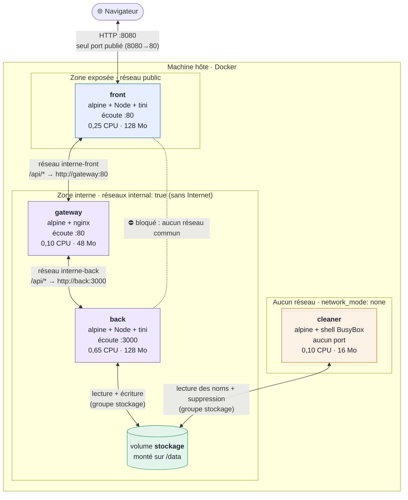
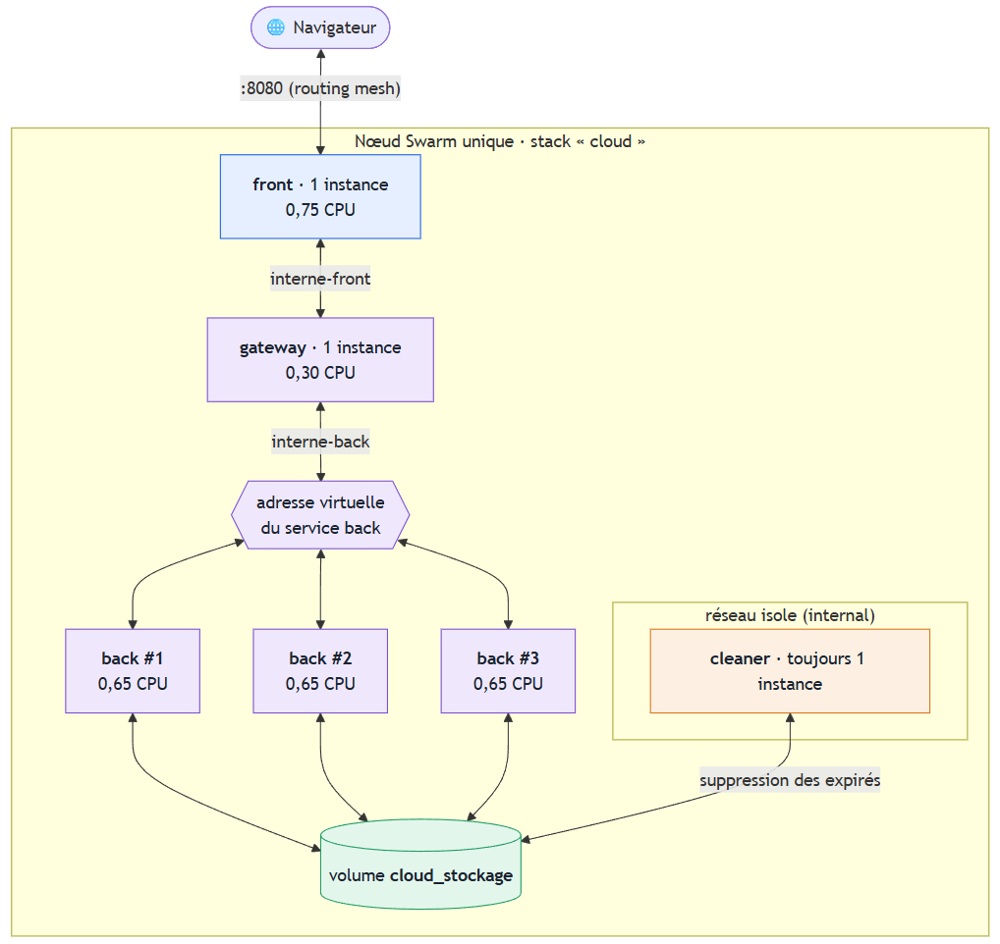
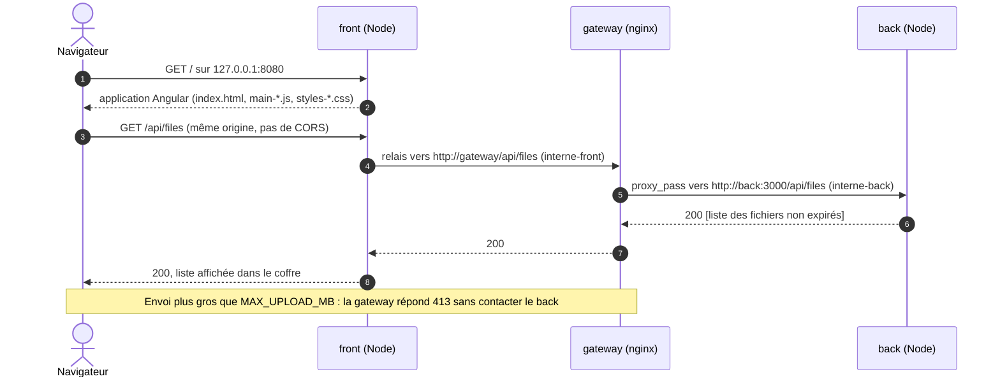
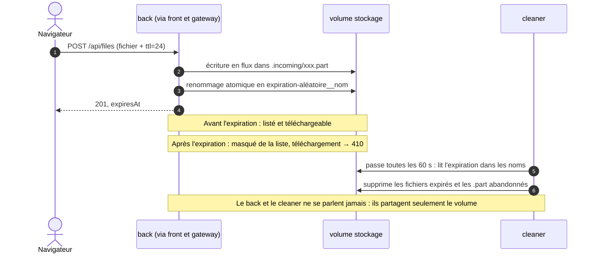
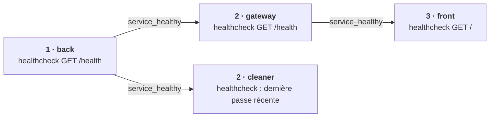

# Architecture

[← Retour au README](../README.md) · [Documentation](README.md)

## Schéma d'architecture : services, réseaux, ports, volume

**Lecture des flèches :** une flèche à double sens représente un **échange** : une requête dans un sens, la réponse dans l'autre (ou, pour le volume, des lectures et des écritures). Le libellé indique **qui ouvre la connexion** (« `/api/*` → `http://gateway:80` » : c'est le front qui appelle la gateway). La gateway ne fait que répondre au front, elle ne l'appelle jamais, et le back ne contacte personne. Le lien en pointillés front ⋯ back est **bloqué** : ces deux services n'ont aucun réseau en commun. Le détail de chaque aller-retour est dans le [schéma des communications](#schéma-des-communications--chemin-dune-requête).

| Élément | À retenir |
|---|---|
| Seul port publié | `8080` sur l'hôte → `80` du front. Aucun autre service n'a de `ports:`. |
| Réseaux | `public` (front), `interne-front` (front + gateway), `interne-back` (gateway + back), **aucun** pour le cleaner. La gateway est le seul pont : le lien direct front → back est bloqué. |
| Volume | `stockage`, monté sur `/data` du back (écriture) et du cleaner (suppression), avec un groupe Unix commun. |
| Ressources | Limites CPU / mémoire par service, issues du `.env` et dimensionnées par un benchmark. |

### Le même schéma en mode Swarm

Mêmes services, mêmes réseaux et même volume : seuls le **nombre d'instances** et la façon de les joindre changent, et un 5e service, l'autoscaler, ajuste ce nombre. Source Mermaid et détail dans la partie [Scalabilité](scalabilite.md#architecture-en-mode-swarm).

| Élément | Ce que montre le schéma |
|---|---|
| Services | Nombre d'instances **variable**, piloté par l'[autoscaler](images/autoscaler.md#image-autoscaler-mode-swarm) : back **2 à 6**, gateway **1 à 3**, front **1 à 2**. Le cleaner reste **toujours à 1** : deux workers supprimeraient les mêmes fichiers. |
| Autoscaler | 1 instance sur le manager ; il agit **par le socket Docker** (en pointillés), jamais par le réseau : son réseau `isole-autoscaler` n'a aucun autre membre. |
| Port | `8080` publié par le **routing mesh** de Swarm : l'hôte reçoit la connexion et la transmet au front. |
| Réseaux | `interne-front` (front, gateway) et `interne-back` (gateway, back) comme dans le compose. Le cleaner est sur `isole` (`internal: true`) : Swarm n'accepte pas `network_mode: none`, ce réseau sans sortie le remplace. |
| Adresse virtuelle | La gateway appelle `back` comme avant ; Swarm lui donne une **adresse virtuelle** et répartit les connexions entre les instances. Aucune config nginx à changer pour ajouter une instance. |
| Volume | `cloud_stockage` (le volume `stockage` préfixé par le nom de la stack) est partagé par toutes les instances du back (lecture et écriture) et le cleaner (suppression). |
| Ressources | back 0,65 CPU chacun, front 0,75 et gateway 0,30 : ils relaient le trafic de plusieurs back, d'où plus de CPU que dans le compose (0,25 et 0,10). Gateway à 96 Mo (48 dans le compose) pour les envois en parallèle. |

## Schéma des communications : chemin d'une requête

Le navigateur ne connaît que le front : il ne peut pas résoudre les noms de service Docker (`gateway`, `back`). C'est le `server.js` du front qui relaie `/api` vers la gateway, puis nginx qui transmet au back.

## Cycle de vie d'un fichier éphémère

## Ordre de démarrage

Chaque service attend que le précédent soit `healthy` (`depends_on: condition: service_healthy`) : la gateway ne reçoit du trafic qu'une fois le back prêt (sinon elle répondrait `502`), le front n'est ouvert qu'une fois toute la chaîne prête, et le cleaner attend que le back ait initialisé les droits du volume.
