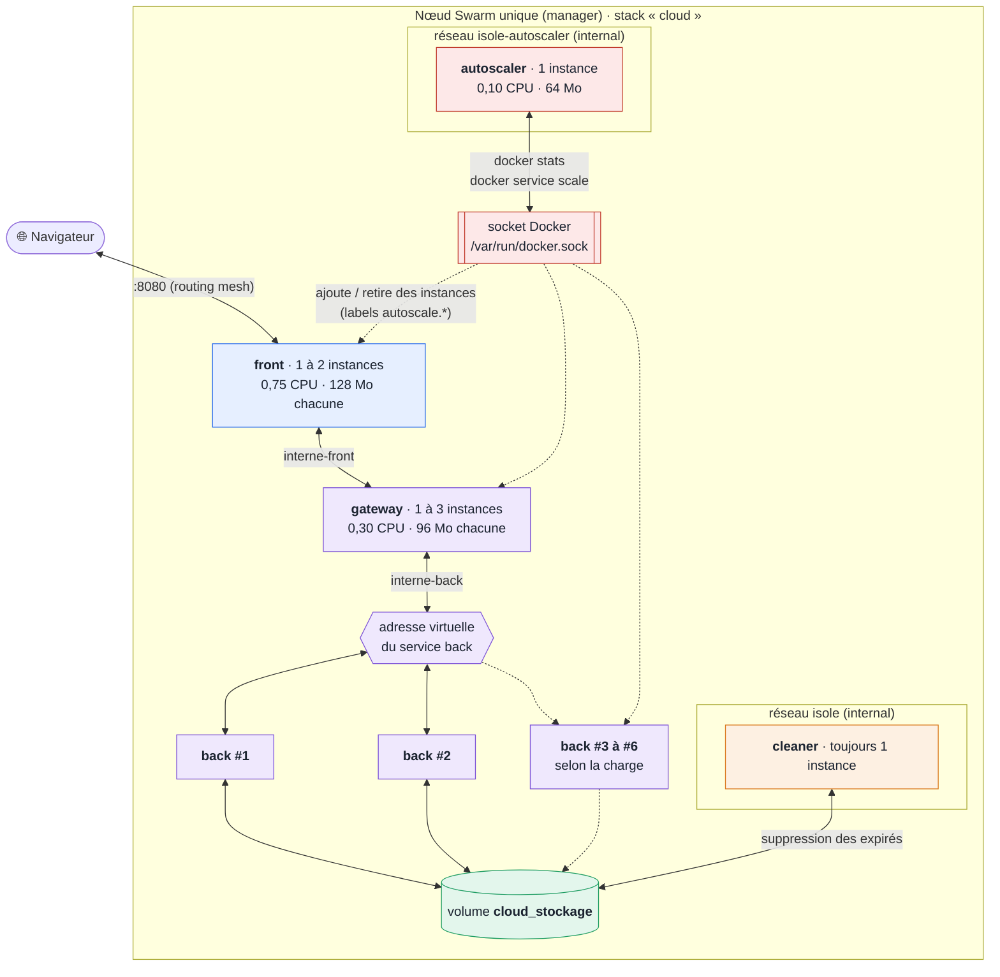

# Scalabilité

[← Retour au README](../README.md) · [Documentation](README.md)

La montée en charge se fait avec **Docker Swarm**, l'orchestrateur natif de Docker : plusieurs instances, réparties automatiquement, relancées si elles tombent, mises à jour sans coupure, et dont le nombre suit la charge grâce à notre [autoscaler](conteneurs/autoscaler.md#image-autoscaler-mode-swarm).

## Déploiement

```bash
docker swarm init                                            # une seule fois : la machine devient un nœud Swarm
powershell -ExecutionPolicy Bypass -File swarm-deploy.ps1    # Windows   (ou ./swarm-deploy.sh sous Linux / macOS)
docker stack services cloud                                  # au repos : back 2/2, gateway 1/1, front 1/1, cleaner 1/1, autoscaler 1/1
docker service logs -f cloud_autoscaler                      # les relevés et les décisions de l'autoscaler
docker stack rm cloud                                        # retrait de la stack (le volume est conservé)
```

Un `docker service scale` à la main reste possible, mais l'autoscaler ramène le service dans ses bornes au relevé suivant.

L'application reste sur **http://127.0.0.1:8080**. La stack Swarm et le compose publient tous les deux ce port : on utilise l'un **ou** l'autre.

> **Arrêt d'urgence** : si la stack consomme trop de RAM ou de CPU et que la machine ralentit, `docker swarm leave --force` quitte le mode Swarm et arrête **toutes** les instances d'un coup (les volumes, donc les fichiers, sont conservés). Plus doux, si la machine répond encore : `docker stack rm cloud` ou `docker service scale cloud_back=1`.

## Pourquoi le compose reste, et pourquoi un fichier Swarm séparé

`docker-compose.yml` reste le fichier principal, et `docker-stack.yml` s'ajoute pour Swarm. Transformer le compose en stack Swarm aurait fait perdre des choses que la stack utilise et que le barème note, car `docker stack deploy` les ignore ou les refuse :

| Élément du compose | En Swarm | Comment c'est traité dans `docker-stack.yml` |
|---|---|---|
| `depends_on: condition: service_healthy` | **Refusé** (ancien format compose v3 : liste simple seulement) | Pas d'ordre de démarrage en Swarm : une instance non `healthy` ne reçoit pas de trafic, et une instance qui échoue est relancée. Le cas des droits du volume est réglé autrement (voir plus bas). |
| `memswap_limit` | **Refusé** (« forbidden property ») | Absent : la limite mémoire est appliquée, mais la swap n'est plus désactivée (limite assumée). |
| `build:` | Ignoré | Les images sont construites par `docker compose build` (dans le script), puis utilisées par Swarm (`image: docker-cloud/*`). |
| `network_mode: none` (cleaner) | Ignoré : le cleaner aurait été branché sur un réseau par défaut, avec Internet | Réseau overlay **`isole`**, `internal: true`, dont le cleaner est le seul membre (vérifié : aucun accès au back ni à Internet). |
| `restart: unless-stopped` | Ignoré | `deploy.restart_policy: on-failure`. |
| `tmpfs: - /tmp:size=8m` | Forme courte non prise en charge | Forme longue `type: tmpfs` avec une taille en octets. |
| `.env` | **Non lu** par `docker stack deploy` | Le script `swarm-deploy.ps1` / `.sh` charge le `.env` dans l'environnement avant de déployer. |

Un fichier de **surcharge** (compose + petit fichier de différences) a été essayé en premier, pour ne rien répéter : `docker stack deploy` le refuse justement à cause de `depends_on` et `memswap_limit` (testé). Il aurait fallu dégrader le compose. `docker-stack.yml` est donc **autonome**, mais seule sa **structure** est répétée : toutes les **valeurs** (versions, ports, CPU, mémoire, durées de vie) viennent du même `.env`.

## Ce que Swarm ajoute

| Réglage (`docker-stack.yml`) | Rôle |
|---|---|
| `replicas` au minimum (back 2, gateway 1, front 1) | Point de départ : l'autoscaler ajoute des instances selon la charge. Back à 2 au minimum : un crash ne coupe pas l'API. Swarm donne à chaque service une **adresse virtuelle** et répartit les connexions entre ses instances : ni la gateway ni le front n'ont rien à connaître. |
| `deploy.labels` `autoscale.*` sur back, gateway, front | Les services que l'autoscaler peut multiplier, et leurs bornes (back 2 à 6, gateway 1 à 3, front 1 à 2). |
| Service `autoscaler` | 1 instance sur le manager, socket Docker monté (voir [Image Autoscaler](conteneurs/autoscaler.md#image-autoscaler-mode-swarm)). |
| `cleaner.deploy.replicas: 1` | **Toujours un seul** worker, quel que soit le nombre de back : plusieurs supprimeraient les mêmes fichiers en même temps. |
| `restart_policy: on-failure` | Auto-réparation : une instance qui tombe est recréée. |
| `update_config: parallelism 1, order start-first, failure_action rollback` | Mise à jour progressive : une instance à la fois, la nouvelle doit être `healthy` avant l'arrêt de l'ancienne, retour arrière automatique en cas d'échec. |
| Réseaux `driver: overlay` | Le type de réseau de Swarm, qui peut s'étendre sur plusieurs machines. Les mêmes réseaux que le compose (`public`, `interne-front`, `interne-back`), plus `isole`. |
| Front et gateway à **0,75 et 0,30 CPU** (`SWARM_FRONT_CPUS`, `SWARM_GATEWAY_CPUS`) | Plus que dans le compose (0,25 et 0,10), parce qu'ils relaient le trafic de plusieurs back : voir le benchmark ci-dessous. |
| Gateway à **96 Mo** (`SWARM_GATEWAY_MEMORY`, 48 dans le compose) | Mesuré à 98 % de 48 Mo pour 10 envois de 40 Mo en parallèle, et `502` à 20. Avec 96 Mo : 61 % à 10 envois, 72 % à 20, plus aucun `502`. Toujours moins que Node (128 Mo). |
| Réseau `isole-autoscaler` | Réseau interne de l'autoscaler seul : il ne joint personne (le socket n'est pas du réseau). |

## Conditions pour que la réplication fonctionne

| Condition | Comment elle est remplie |
|---|---|
| **Back sans état** | L'expiration est inscrite dans le nom des fichiers et les fichiers sont dans un volume partagé : aucune donnée en mémoire, n'importe quelle instance répond à n'importe quelle requête. Vérifié : 3 instances différentes répondent, et chacune voit tous les fichiers. |
| Pas de port publié sur le back | Seul le front est publié ; la gateway est le seul accès au back. |
| Noms de fichiers uniques | Préfixe aléatoire : deux instances qui écrivent en même temps n'écrasent rien. |
| La gateway voit les nouvelles instances | En compose : `resolver 127.0.0.11` (DNS Docker interrogé toutes les 10 s). En Swarm : adresse virtuelle du service `back`, répartie par Swarm lui-même. |
| **Volume utilisable quel que soit l'ordre de démarrage** | Sans `depends_on`, Swarm peut démarrer le cleaner avant le back. Le premier conteneur qui monte un volume vide y recopie le dossier de son image : l'image du cleaner contient donc **le même dossier** que celle du back (`/data/files/.incoming`, groupe `stockage`, `2775`). Vérifié : volume neuf initialisé par le cleaner (`drwxrwsr-x cleaner stockage`), le back y écrit quand même (`201`). |

## Ressources : limites, réservations et plafond

Les limites de `deploy.resources.limits` s'appliquent **à chaque instance** : elles protègent d'une instance qui s'emballe, mais **pas d'une multiplication des instances** (5 back × 0,65 CPU = 3,25 CPU). Une commande excessive, ou un autoscaler mal réglé, pourrait saturer la machine. Trois garde-fous sont donc en place :

| Garde-fou | Réglage | Test |
|---|---|---|
| **Réservations CPU et mémoire** | `reservations.cpus` : back 0,30, front 0,10, gateway et cleaner 0,05 (la stack de base réserve ~1,1 CPU sur les 12 de la machine) | Le planificateur ne place une instance que si les ressources réservées sont disponibles. Test volontairement excessif, 5 CPU réservés par instance du back : la 3e reste **`Pending`** (« no suitable node (insufficient resources) »), l'ancienne instance continue de tourner (`start-first`), l'application répond toujours `200`. |
| **Plafond par machine** | `placement.max_replicas_per_node: 6` (`BACK_MAX_REPLICAS_PER_NODE`) : au pire 3,9 CPU et 768 Mo, environ un tiers de la machine | 9 instances demandées : **6 tournent, les autres restent `Pending`** (« no suitable node (max replicas per node) »). |
| **Budget de l'autoscaler** | Somme des limites de toutes les instances ≤ **80 %** du CPU et de la mémoire de la machine (`AUTOSCALE_HOST_BUDGET_PCT`), vérifiée avant chaque ajout | Budget abaissé à 30 % pour le test : 3 montées **refusées** et journalisées (« la stack dépasserait 30 % de la machine (cpu 35 % après ajout) »). |

## Démonstrations (mesurées)

| Démonstration | Commande | Résultat |
|---|---|---|
| Répartition | requêtes successives sur `/api/files` | 3 valeurs différentes de `X-Served-By`, mêmes fichiers vus partout |
| **Montée en charge à chaud** | `docker service scale cloud_back=5` | 5/5 en 17 s, 5 instances différentes répondent |
| **Auto-réparation** | `docker kill` d'une instance du back | Recréée en 13 s ; **179 requêtes pendant ce temps, 0 erreur** |
| **Mise à jour sans coupure** | `docker service update --force cloud_back` | 3 instances remplacées une par une en 61 s ; **520 requêtes pendant ce temps, 0 erreur** |
| Arrêt propre des instances retirées | `docker service scale cloud_back=1` | `Exited (0)` pour chaque instance arrêtée |
| **Persistance** | `docker stack rm cloud` puis redéploiement | Volume conservé, fichier intact |
| Isolation | `wget` depuis les conteneurs | Cleaner : seul son réseau `isole`, ni back ni Internet ; front → back bloqué ; back sans Internet |

## Benchmark en mode Swarm

`ab` est lancé comme service Swarm ponctuel sur le réseau `public` de la stack : il attaque le front comme le service `bench` du compose, les mesures sont donc comparables (route `/api/files`, 20 fichiers, 5 000 requêtes à 50 en parallèle).

| Configuration | Req/s | p95 | Échecs |
|---|---|---|---|
| Compose : 1 back (référence, benchmark étape 6) | 166 | 389 ms | 0 |
| Swarm : 1 back, front 0,25 / gateway 0,10 | 153 | 611 ms | 0 |
| Swarm : 3 back, front 0,25 / gateway 0,10 | 153 | 539 ms | 0 |
| Swarm : 5 back, front 0,25 / gateway 0,10 | 154 | 502 ms | 0 |
| Swarm : 5 back, front 0,75 / gateway 0,30 | 417 | 210 ms | 0 |
| **Swarm, stack par défaut : 3 back, front 0,75 / gateway 0,30** | **431 à 574** | **197 à 278 ms** | **0** |

**Ajouter des instances du back ne suffit pas.** Avec 3 ou 5 back mais un front et une gateway au dosage du compose, le débit ne bouge pas : le goulot s'est simplement déplacé vers le front et la gateway. En leur donnant du CPU dans le rapport de coûts mesuré (back / front / gateway ≈ 7 / 3 / 1), le débit est multiplié par **2,8 à 3,7** par rapport au compose. Dans la stack par défaut, les trois services arrivent ensemble près de leur limite (pics : back 68 %, front 68 %, gateway 31 %) : le dosage est équilibré.

## Autoscaling : le nombre d'instances suit la charge

Objectif : ajouter des instances **avant** qu'un service sature, les retirer quand la charge retombe, avec deux règles : **ne jamais dépasser 80 % du CPU** alloué à un service ni de la machine, et ne jamais approcher la **limite mémoire** (OOM : conteneur tué par le noyau). Le service qui le fait est notre [image Autoscaler](conteneurs/autoscaler.md#image-autoscaler-mode-swarm).

### Benchmark de dimensionnement

Avant de fixer des seuils, il fallait savoir **ce que tient une instance** de chaque service. Mesure en Swarm, `ab` en service ponctuel sur le réseau `public` (4 000 requêtes de liste par scénario, 1 / 2 / 3 / 5 back × 10 / 25 / 50 / 100 requêtes en parallèle : **64 000 requêtes, 0 échec**), CPU exprimé en % de la **limite** du service.

| Back | Req/s (selon la concurrence) | CPU back | CPU gateway | CPU front |
|---|---|---|---|---|
| 1 | 139 à 155 | **102 à 107 %** | 35 à 51 % | 28 à 74 % |
| 2 | 258 à 325 | **100 à 103 %** | 60 à 79 % | 43 à 56 % |
| 3 | 369 à 546 | **102 à 105 %** | **89 à 101 %** | 60 à 70 % |
| 5 | 310 à 494 | 60 à 89 % | **104 à 107 %** | 57 à 79 % |

- Jusqu'à 3 back, le **back** sature le premier et le débit monte presque linéairement : **~140 à 150 req/s par instance** à 100 %, soit **~110 req/s à 80 %**.
- Dès 3 back, la **gateway** sature à son tour (~500 req/s, ~400 à 80 %) : avec 5 back, le débit ne monte plus, et chute même à forte concurrence. **Multiplier le back seul ne suffit pas** : l'autoscaler pilote aussi la gateway et le front.
- Le **front** garde de la marge (79 % au pire) : ~550 req/s à 80 %.

Même logique pour la mémoire, avec des envois de fichiers de 40 Mo en parallèle (la lecture, elle, ne fait pas bouger la mémoire) :

| Envois simultanés | Gateway (48 Mo) | Front (128 Mo) | Back (128 Mo, pire instance) |
|---|---|---|---|
| 5 | 61 % | 50 % | 42 % |
| 10 | **98 %** | 77 % | 49 % |
| 20 | **100 %, 11 `502` sur 20** | 91 % | 45 % |

La gateway est le premier risque OOM : sa mémoire passe à **96 Mo en Swarm** (voir [Ce que Swarm ajoute](#ce-que-swarm-ajoute)). Le back n'est jamais en danger : il écrit en flux sur le disque.

### Nombre d'instances selon la charge

| Charge (req/s) | back | gateway | front | CPU réservé en limites |
|---|---|---|---|---|
| < 110 | 1 | 1 | 1 | 1,7 |
| 110 à 220 | 2 | 1 | 1 | 2,35 |
| 220 à 330 | 3 | 1 | 1 | 3,0 |
| 330 à 440 | 4 | 2 | 1 | 3,95 |
| 440 à 550 | 5 | 2 | 1 | 4,6 |
| 550 à 660 | 6 | 2 | 2 | 6,0 |

D'où les bornes : **back 2 à 6** (2 pour la disponibilité ; 6 = `BACK_MAX_REPLICAS_PER_NODE`), **gateway 1 à 3**, **front 1 à 2**. Au-delà, plus d'instances n'apportent rien. Même tout au maximum (avec cleaner et autoscaler), la stack ne réserve que **~6,5 CPU sur 12 (54 %)** et **~1,4 Go sur 7,6 (19 %)** : sous les 80 %.

### Seuils retenus

| Réglage | Valeur | Pourquoi |
|---|---|---|
| Monter d'une instance | CPU moyen > **70 %** ou mémoire > **80 %** | 70 % et pas 80 % : une instance met 10 à 15 s à être prête, la charge continue de monter pendant ce temps. |
| Descendre d'une instance | CPU < **25 %** et mémoire < **50 %** | Écart large avec le seuil de montée (**hystérésis**) : sinon retirer une instance ferait remonter la charge au-dessus de 70 %, et le service oscillerait. |
| Relevés consécutifs | **3** pour monter, **6** pour descendre | Un pic isolé ne crée pas d'instance ; retirer trop vite coûte plus cher que garder une instance. |
| Pause après une action | **30 s** (montée), **60 s** (descente) | La nouvelle instance doit prendre sa part de la charge avant qu'on remesure. |
| Intervalle | **10 s** (~14 s avec le relevé) | Plus souvent, l'autoscaler chargerait la machine qu'il surveille. |
| Budget machine | **80 %** | La consigne, appliquée à la somme des limites de toute la stack. |

### Ce qui change par rapport à l'exemple fourni

L'exemple du cours (`autoscale.sh` + `Dockerfile.autoscaler`) donne le principe : une image alpine avec `docker-cli`, le socket monté, un placement sur un manager, `docker service scale` à ±1 instance. Ses défauts, corrigés ici :

| Dans l'exemple | Problème | Ici |
|---|---|---|
| **Somme** du CPU des instances comparée à 80 | La somme grandit avec le nombre d'instances : le service continue de monter alors que chaque instance est peu chargée. | **Moyenne** des instances. |
| CPU en % d'**un cœur** | Une instance saturée à 0,65 CPU affiche 65 % : le seuil de 80 % ne serait **jamais** atteint. | CPU en % de la **limite** du service, lue dans le service. |
| Aucun délai entre deux actions, un seul relevé | Une instance n'a pas fini de démarrer qu'une autre est déjà demandée. | Relevés consécutifs, pauses après action, hystérésis. |
| Un service, nom en dur | Le goulot se déplace (back → gateway → front). | Plusieurs services, désignés par **labels**, bornes par service. |
| CPU seulement | La gateway risque l'OOM avant la saturation CPU. | CPU **et** mémoire. |
| Aucune limite globale | Rien n'empêche de saturer la machine. | Budget de **80 %** de la machine. |
| `bash`, `curl`, `alpine:3.18`, root, pas de limites | Outils inutiles, version en fin de vie, aucun durcissement. | Alpine 3.22, `docker-cli` seul, non-root, lecture seule, 0,10 CPU / 64 Mo. |
| `sleep` au premier plan, pas de `trap` | `docker stop` attend 10 s puis tue le conteneur (code `137`). | `trap` + `sleep & wait` : arrêt en 0,6 s, code `0`. |

### Démonstrations (mesurées)

Charge de 3 minutes (`ab` en service ponctuel), puis repos, avec le suivi du nombre d'instances toutes les 10 s :

| Moment | Ce que fait l'autoscaler |
|---|---|
| Départ | back 2, gateway 1, front 1 (les minimums) |
| +41 s | back à **103 %** sur 3 relevés → **back 2 → 3** (« machine après ajout : cpu 35 % ») |
| +92 s | la gateway devient le goulot (**98 %**) → **gateway 1 → 2** |
| Ensuite | plus aucun service au-dessus de 70 % sur 3 relevés : rien à ajouter |
| Fin de charge + 72 s | 6 relevés sous 25 % → **back 3 → 2, gateway 2 → 1**, sans oscillation |

| Test | Résultat |
|---|---|
| Charge à 50 en parallèle (3 min) | 45 992 requêtes, **0 échec** |
| Charge à 150 en parallèle (3 min) | 48 143 requêtes, **0 échec**, même trajectoire |
| Budget machine abaissé à 30 % | 3 montées **refusées** et journalisées |
| Scale manuel à 8 (borne max 6) | ramené à **6** au relevé suivant |
| 20 envois de 40 Mo en parallèle (gateway à 96 Mo) | plus aucun `502` (11 avant) ; 5 refus `507` voulus (quota de 1 Go) |

Extrait des logs (`docker service logs cloud_autoscaler`) :

```
cloud_back : 2 -> 3 instance(s) (cpu 103 %, mem 22 % au-dessus des seuils 70 % / 80 % sur 3 relevés ; machine après ajout : cpu 35 %, mem 9 %)
cloud_gateway : 1 -> 2 instance(s) (cpu 98 %, mem 6 % au-dessus des seuils 70 % / 80 % sur 3 relevés ; machine après ajout : cpu 37 %, mem 11 %)
cloud_back : 3 -> 2 instance(s) (cpu 0 %, mem 21 % sous les seuils 25 % / 50 % sur 6 relevés)
```

### Ce que l'autoscaler ne règle pas (constaté)

| Constat | Explication |
|---|---|
| **Rafale d'envois et front** | 20 envois de 40 Mo en parallèle mènent le front à **99 %** de ses 128 Mo (et 1 020 envois simultanés, lors d'une fausse manipulation, l'ont fait tuer par OOM, puis relancer par Swarm). Une rafale dure ~15 s, moins que les ~40 s (3 relevés) dont l'autoscaler a besoin : il réagit trop tard. La protection doit venir du front lui-même (plus de mémoire en Swarm, ou nombre d'envois simultanés limité) : amélioration identifiée, non faite. |
| **Latence à forte concurrence sans service saturé** | À 150 requêtes en parallèle, back, front et gateway retombent par moments ensemble près de 0 % de CPU pendant que des requêtes attendent (p95 de 2,4 s). L'ouverture des connexions n'est pas en cause (19 ms au plus) : ce sont des pauses dans la chaîne front → gateway → back, qu'ajouter des instances ne corrige pas. L'autoscaler ne monte donc pas, ce qui est le bon comportement. |
| **Réaction en ~40 s** | Choix assumé (3 relevés) : un autoscaler plus nerveux réagirait aux pics isolés et oscillerait. |

## Limites assumées

- **Un seul nœud.** Plusieurs machines demanderaient un registre d'images partagé (l'image `registry:2` vient du Docker Hub, interdite par le sujet) et un stockage partagé entre machines (un volume local n'existe que sur sa machine ; il faudrait NFS ou équivalent).
- **Pas d'auto-scaling natif dans Swarm**, comme le précise le cours : il est fait par notre [autoscaler](conteneurs/autoscaler.md#image-autoscaler-mode-swarm), au prix d'un accès au socket Docker (risque assumé et réduit, voir sa partie Sécurité).
- **Swap non désactivable** en Swarm (`memswap_limit` refusé).
- Les instances arrêtées restent visibles quelques minutes (`docker ps -a`) : c'est l'historique des tâches de Swarm.

## Architecture en mode Swarm



Les flèches en pointillés sont ce qui **varie** : les instances 3 à 6 du back n'existent que sous charge, et l'autoscaler agit sur les services **à travers le moteur Docker** (le socket), jamais par le réseau.

## Pourquoi c'est un avantage de Docker par rapport aux VM

| | Machines virtuelles | Conteneurs Docker (mesuré sur cette stack) |
|---|---|---|
| Ajouter une instance | Créer et démarrer une VM complète (OS invité) : plusieurs minutes, plusieurs Go | `docker service scale` : 2 instances de plus en **17 s**, environ **27 Mo** de mémoire chacune |
| Remplacer une instance en panne | Intervention, ou outillage dédié | Automatique : **13 s**, sans aucune requête perdue |
| Mettre à jour | Arrêt de service, ou bascule manuelle | Remplacement progressif : **0 erreur** sur 520 requêtes |
| Empreinte de toute l'application | Un OS complet par VM | **~100 Mo** de RAM au repos pour les 6 conteneurs |
| Configuration | À reproduire sur chaque VM | Identique pour toutes les instances : elles viennent de la même image |
